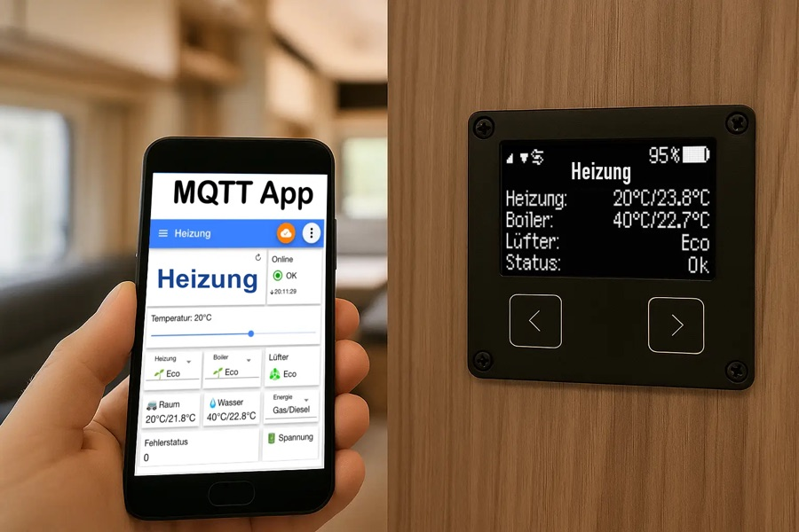

# Heater control

[🇩🇪 Deutsch](../de/heizung.md) | 🇬🇧 English · [← back to overview](../../README.en.md)

  

With the **[TIN adapter](https://www.blue-battery.com/product-page/tin-adapter)** on the BB-Display you control the heater from Home Assistant – from the sofa, on the way or automatically (see [frost protection](examples.md#frost-protection) and [pre-heating](examples.md#pre-heating)).

## Truma

Combi with CP plus iNet ready, via the TIN adapter:

- **Thermostat:** off / heat, level **eco** or **high**, room setpoint 5–30 °C
- **Boiler:** Off / Eco (40 °C) / High (55 °C) / Boost (60 °C)
- **Display:** room and water temperature, fan level, error code, fault in plain words, last fault, connection
- **Energy source** (gas / mix / electric) on **Combi E** – enable in the integration options under "Advanced"
- Additional heating levels (VarioHeat, boost) can also be enabled under "Advanced"

## Alde – 🧪 experimental

Compact 3020 HE / 3030: thermostat zone 1 (and zone 2 if present), hot water, gas, electric level 1–3 kW, priority, outdoor temperature.

You have an Alde with TIN adapter? A [diagnostics export](faq.md#how-do-i-report-a-bug) helps a lot to complete the support.

## How control works

- **Commands with verification:** the integration checks every command against the next status of the BB-Display and shows while it is pending. Depending on the heater it is applied within a few seconds up to about 30 seconds – with the Truma Combi in our test after about 6 seconds.
- **Boiler boost detected:** during Truma boiler boost the Truma briefly holds back room heating so the water heats up faster. The integration shows this as *"room heating paused"*.
- **Faults at a glance:** a fault is reported within seconds with error code and plain-language text, e.g. *"E202H: Flame/gas fault – check cylinder, valves, regulator and flue"* – ideal for [notifications](examples.md#heater-fault-notification). The heater is still shown as *connected*. As intended by the heater, the fault is reset directly on the control panel (e.g. CP plus); the heater then continues with its previous settings.
- **"No fault reported"** means the heater is not reporting an error right now. After a reset it can return at the next start attempt if the cause persists. The **Last fault** sensor keeps the message, with start and end time.
- **Fault texts:** they apply to the Truma Combi running on gas; on diesel models some codes mean something else. The heater's manual is authoritative. For Alde the integration shows the heater's own text.
- **After a display restart** the integration gives the heater 1–2 minutes to establish its connection before reporting a fault – so there are no false alarms.
